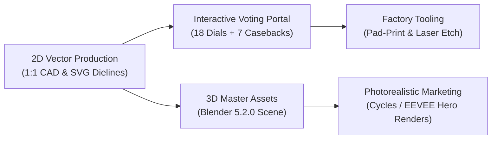
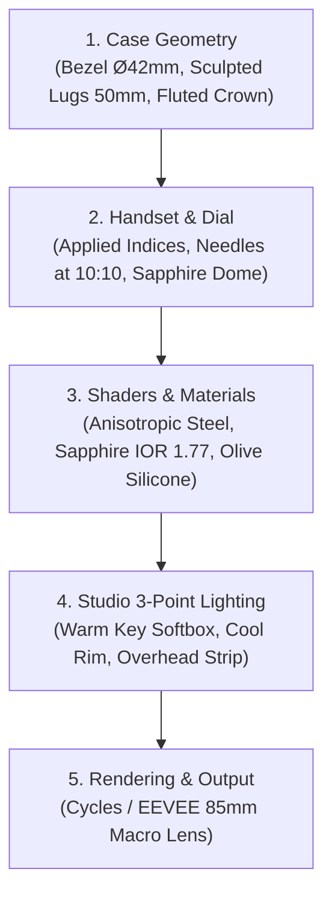

# VR Universal — Watch Design & 3D Engineering Handoff

> **Project:** VR Universal — Military Defence System Edition (DSA 2026 Timepiece Suite)  
> **Target Audience:** Industrial Watch Designers, CNC Machinists, Dial Pad-Printers, 3D Artists, and Brand Stakeholders  
> **Live Voting Portal:** [https://tokorei.github.io/vr-universal-watch-voting/](https://tokorei.github.io/vr-universal-watch-voting/)  
> **Source Repository:** [https://github.com/tokorei/vr-universal-watch-voting](https://github.com/tokorei/vr-universal-watch-voting)  
> **Local Master Workspace:** `/Users/nicchan/Downloads/General`

---

## 1. Executive Summary & Design Overview

This handoff document consolidates the complete technical specifications, 2D vector dielines, mechanical tolerances, and 3D modeling pipeline for the **VR Universal Military Defence System Edition** tactical watch collection.



### Key Deliverables Summary

| Deliverable | Format | File Location / Link |
| :--- | :--- | :--- |
| **18 Front Dials Showcase** | SVG / High-Res PNG | [VR_Universal_18_Front_Dials_Master_Showcase.svg](file:///Users/nicchan/Downloads/General/VR_Universal_18_Front_Dials_Master_Showcase.svg) |
| **7 Laser Casebacks Showcase** | SVG / High-Res PNG | [VR_Universal_7_Casebacks_Master_Showcase.svg](file:///Users/nicchan/Downloads/General/VR_Universal_7_Casebacks_Master_Showcase.svg) |
| **3D Master Blender Scene** | `.blend` (Blender 5.2.0) | [VR_Universal_Tactical_Watch_3D_Master.blend](file:///Users/nicchan/Downloads/General/VR_Universal_Tactical_Watch_3D_Master.blend) |
| **3D Blender Hero Render** | 1920×1080 PNG | [VR_Universal_Tactical_Watch_3D_Blender_Hero.png](file:///Users/nicchan/Downloads/General/VR_Universal_Tactical_Watch_3D_Blender_Hero.png) |
| **3D Automated Generator Script** | Python (Headless / GUI) | [generate_blender_watch_3d.py](file:///Users/nicchan/Downloads/General/generate_blender_watch_3d.py) |
| **Interactive Voting Suite** | Standalone HTML5 / JS | [vr_universal_voting_app.html](file:///Users/nicchan/Downloads/General/vr_universal_voting_app.html) |
| **Laser Outlines Production Sheet** | 1:1 Scale Vector PDF | [Laser_Engraving_Production_Outlines_1to1.pdf](file:///Users/nicchan/Downloads/General/Laser_Engraving_Production_Outlines_1to1.pdf) |
| **Master 5 Brands Catalog** | Multi-Page PDF | [Main_5_Brands_Watches_V2_Master_Catalog.pdf](file:///Users/nicchan/Downloads/General/Main_5_Brands_Watches_V2_Master_Catalog.pdf) |

---

## 2. Core Watch Dimensions & Branding Hierarchy

All 18 front dials adhere strictly to the **calibrated branding hierarchy** verified against the factory prototype reference.

```
                              [12H Bezel]
                                   │
              y = cy - 5.41mm  ─── ◈ VRU Shield Logo (Ø 3.10mm)
                                   │ 0.36mm Clean Gap (NO CLIPPING)
              y = cy - 2.80mm  ─── █ "VR UNIVERSAL" (0.92mm text height)
                                   │
              y = cy           ─── ⦿ Center Pinion (r = 0.75mm)
                                   │
              y = cy + 6.15mm  ─── ▬ "Military Defence System" (0.74mm text height)
                                   │
                              [ 6H Bezel]
```

### Exact Geometric Dimensions

| Feature | Radius ($r$) / Offset ($y$) | Diameter / Dimensions | Manufacturing Notes |
| :--- | :--- | :--- | :--- |
| **Dial Plate Outer** | $r = 16.50\text{ mm}$ | $\varnothing 33.00\text{ mm}$ | Brass base, polar matte white ceramic coating |
| **Printed Track Limit** | $r = 15.43\text{ mm}$ | $\varnothing 30.86\text{ mm}$ | Outer minute index boundary |
| **VRU Shield Emblem** | Center: $cy - 5.41\text{ mm}$ | $\varnothing 3.10\text{ mm}$ | Navy ring (`#0066CC`), white crest outline |
| **"VR UNIVERSAL" Baseline** | Baseline: $cy - 2.80\text{ mm}$ | Font size: $0.92\text{ mm}$ | Cap height $0.70\text{ mm}$; top at $cy - 3.50\text{ mm}$ |
| **Unclipped Clearance Gap** | $0.36\text{ mm}$ buffer | Height: $0.36\text{ mm}$ | Guaranteed zero character clipping |
| **Center Pinion Hub** | Center: $cy = 0.00\text{ mm}$ | Hub $\varnothing 1.50\text{ mm}$, Pin $\varnothing 0.50\text{ mm}$ | Steel friction collar |
| **"Military Defence System"** | Baseline: $cy + 6.15\text{ mm}$ | Font size: $0.74\text{ mm}$ | Pad-printed matte black `#0F172A` |

---

## 3. Front Dial Collection: 18 Variations

The 18 designs are structured into two distinct suites: **Designs 01–12 (Tactical & Mil-Spec)** and **Designs 13–18 (Famous Horology Homages)**.


### Suite A: Tactical & Mil-Spec (Dials 01–12)

1. **#01. Factory Reference 1:1 Plaque Edition**: Exact 1:1 replica of factory prototype reference (`media_1793862724498_9d8d917a.jpg`). Features framed plaques at 12-3-6-9 with bold Arabic numerals, 8 faceted black wedge batons, concentric groove ring with 5-minute numerals (`60`, `05`, `10` ... `55`).
2. **#02. Minimalist Field Baton**: Clean German field-watch layout with faceted double batons at cardinal points, hairline railway minute ring, and uncluttered white negative space.
3. **#03. Big Stencil Aviator (Flieger Type B)**: Oversized bold stencil military numerals (12, 3, 6, 9) printed directly on the dial surface with aviation hash marks.
4. **#04. Tactical Crosshair Telemetric**: Ballistic targeting reticle in cyan (`#00AEEF`) with concentric range rings and azimuth angle telemetry callouts (`090°` / `270°`).
5. **#05. Two-Tone Sector Explorer**: Concentric two-tone sector dial: outer railway minute track, silver-white sector chapter ring with numerals, and polar white center disc.
6. **#06. Field Combat 24-Hour (Army Spec)**: Military field heritage featuring standard 1–12 outer numbers paired with an inner 13–24 military hours track with red `24H` marker.
7. **#07. Ballistic Sub-Seconds Reticle**: Chronograph aesthetic featuring an active running seconds sub-dial at 9H with a red needle and cyan sub-track.
8. **#08. Cyber Honeycomb Geometric**: Laser-etched micro-hexagonal geometric matrix across the dial center, reflecting VR Universal’s virtual simulation technology.
9. **#09. Circular Brushed Sunburst**: Fine snailing lathe reflection with circular brushed metallic silver-white texture and faceted high-shine hour wedges.
10. **#10. Heavy Armored Trench Bevel**: Industrial armored outer trench with 12 recessed cogwheel teeth notches, rugged step bezel, and cyan navigation pips.
11. **#11. Maritime Diver 300M**: Classic military diver layout: inverted 12H triangle, circular luminescent hour plots, and high-visibility baton markers.
12. **#12. Stealth Monochrome Operative**: Non-reflective stealth black/white monochrome VRU badge, matte black hardware, and bold uppercase `MILITARY DEFENCE SYSTEM`.

### Suite B: Famous Watchmaker Homages (Dials 13–18)

13. **#13. IWC Schaffhausen Pilot Flieger Mark XVIII Homage**: Iconic 12H orientation triangle flanked by twin luminescent dots, clean German Bauhaus pilot numerals (1 to 11), and perimeter railway minute track.
14. **#14. Rolex Explorer 3-6-9 Heritage Homage (Ref 1016/124270)**: Legendary open art-deco 3-6-9 typography, prominent inverted 12H triangle, and elongated luminous baton indices.
15. **#15. Panerai Luminor Stencil Sandwich Homage (PAM 00111)**: Multi-layered sandwich dial aesthetic with recessed stencil cutouts for 12, 3, 6, 9, subtle drop-shadow depth, and stadium pill markers.
16. **#16. Bell & Ross BR 03-92 Flight Instrument Homage**: Aviation flight cockpit altimeter gauge, 4 diagonal corner bezel screws, altimeter sub-track, and bold square aviation block typography.
17. **#17. Audemars Piguet Royal Oak Grand Tapisserie Homage**: 3D square pyramidal waffle guilloché dial, faceted double-baton hour markers at 12H, and tension minute ring.
18. **#18. Breitling Navitimer Slide-Rule Flight Computer Homage**: Outer rehaut circular logarithmic flight computer calculation scale, dual speed scales (MPH/Knots), and cardinal red aviation accents.

---

## 4. Caseback Laser Engraving & Mechanical Clearances

The watch caseback utilizes screw-down 316L stainless steel with **6 tool opening notches** located at $60^\circ$ increments ($r_{\text{notch}} = 15.75\text{ mm}$, notch depth $= 0.75\text{ mm}$, width $= 2.0\text{ mm}$).


> [!IMPORTANT]
> **Mechanical Safety Keep-Out Zone Standard:**  
> The maximum outer radius for laser engraving is strictly capped at **$r_{\text{laser}} \le 12.87\text{ mm}$**.  
> This guarantees an uncompromised mechanical safety clearance of **$\ge 2.13\text{ mm}$** from the tool notches ($15.00\text{ mm} - 12.87\text{ mm} = 2.13\text{ mm}$). Under no circumstances should laser engraving cross into the notch zone.

```
   [Outer Case Boundary: R = 16.50mm]
   ┌────────────────────────────────────────────────────────┐
   │                                                        │
   │   [Tool Notch: R = 15.75mm, Inner Edge = 15.00mm]     │
   │   ░░░░░░░░░░░░░░░░░░░░░░░░░░░░░░░░░░░░░░░░░░░░░░░░░    │
   │                                                        │
   │   ▲▲▲ SAFETY BUFFER: 2.13mm KEEP-OUT ZONE ▲▲▲          │
   │                                                        │
   │   ──────────────────────────────────────────────────   │
   │   [Outer Laser Annealed Ring: R = 12.87mm]             │
   │     170° Curved Text: "VR UNIVERSAL • 5ATM ..."        │
   │   [Inner Laser Ring: R = 9.24mm]                       │
   │   ──────────────────────────────────────────────────   │
   │                                                        │
   │   [Central Deep-Frosted Laser Medallion: R = 7.40mm]   │
   │                                                        │
   └────────────────────────────────────────────────────────┘
```

### The 7 Caseback Editions

1. **#01. Circular Brushed 316L Medallion**: Concentric satin-brushed finish, centered VR shield medallion, snailing rings, and annealed perimeter specifications.
2. **#02. Matte Dark Laser Engraving**: Tactical non-reflective PVD matte black caseback with frosted white laser engraving for stealth night operations.
3. **#03. Tactical Radar Crosshair Grid**: Concentric radar tracking coordinates, range rings, and Kuala Lumpur defence expo coordinates (`03°08'N 101°41'E`).
4. **#04. Frosted Center & Technical Rim**: Prominent centered VR shield medallion with crisp perimeter laser-engraved certification track (`DSA 2026 MALAYSIA • LIMITED 500`).
5. **#05. Omega Seahorse Crest Medallion Homage**: Snailing concentric lathe rings, deep frosted centre medallion featuring the VR shield framed by victory laurel wreaths.
6. **#06. IWC Top Gun Supersonic Stealth Homage**: Stealth PVD black base with laser-etched supersonic delta-wing jet silhouette and Mach 2.5 flight telemetry.
7. **#07. Breitling Aeronautic Wings & Perlage Homage**: Overlapping circular engine-turned perlage pearling finish with aeronautic wings bearing the central VR shield.

---

## 5. How to Make the 2D Vector CAD Templates

For factory tooling, dielines, and pad-printing plates, follow this strict vector workflow.

### Software Requirements
- **Vector CAD / Illustration:** Adobe Illustrator (CC 2024+), CorelDraw, or Affinity Designer.
- **Color Mode:** CMYK (for print production) + Spot Colors (for dielines and selective finishes).
- **Scale:** **1:1 Metric Scale** ($1.000\text{ mm}$ on artboard $= 1.000\text{ mm}$ physical part).

### Step-by-Step Production Guide

#### Step 1: Artboard & Coordinate Setup
1. Create a new document in Adobe Illustrator with artboard dimensions **$50.00\text{ mm} \times 50.00\text{ mm}$**.
2. Set rulers to Millimeters (`mm`). Place origin `(0, 0)` at the exact center of the artboard ($x = 25.00\text{ mm}, y = 25.00\text{ mm}$).
3. Draw a guide circle at $R = 16.50\text{ mm}$ ($\varnothing 33.00\text{ mm}$) to denote the dial boundary.
4. Draw a guide circle at $R = 0.75\text{ mm}$ ($\varnothing 1.50\text{ mm}$) to denote the center pinion piercing.

#### Step 2: Layer Architecture
Separate artwork into production layers so the dial manufacturer can create individual cliché printing plates:

```
├── Layer 01: [DIELINE_CUTTING] (Spot Color: 100% Magenta, Hairline 0.05mm, Non-printing)
├── Layer 02: [PAD_PRINT_WHITE_BASE] (Spot Color: Undercoat white for high opacity)
├── Layer 03: [PAD_PRINT_BLACK_ARTWORK] (Pantone Black 6C: Numerals, batons, minute railway tracks)
├── Layer 04: [PAD_PRINT_BLUE_ACCENTS] (Pantone 2935C: VR Corporate Blue emblem ring)
├── Layer 05: [PAD_PRINT_RED_ACCENTS] (Pantone 186C: Red seconds markings, 24H callout)
├── Layer 06: [LUMINOVA_COATING] (Spot Color: Super-LumiNova BGW9 / C3 index fill)
└── Layer 07: [LASER_ENGRAVING_OUTLINES] (RGB Black hairline paths, closed vectors for CNC fiber laser)
```

#### Step 3: Typography & Text Path Rules
- **Text Conversion:** All typography ("VR UNIVERSAL", "Military Defence System", numbers) must be **converted to outlines** (`Ctrl + Shift + O` / `Cmd + Shift + O`) prior to production export.
- **Minimum Stroke Width:** Pad-printed hairline tracks must not be thinner than **$0.08\text{ mm}$** to prevent ink bleeding or breakage on the silicone pad transfer.
- **Concentric Text Arcs:** Caseback curved text must follow continuous SVG `<textPath>` or circular paths with centered alignment (`startOffset="50%"` and `text-anchor="middle"`).

---

## 6. How to Make the 3D Models and Photorealistic Renders

We have engineered an automated, scriptable 3D generation workflow utilizing **Blender 5.2.0 LTS**.


### Automated 1-Click Blender Execution

The full 3D watch can be generated, textured, lit, and rendered with a single command from your terminal:

```bash
/Applications/Blender.app/Contents/MacOS/Blender -b -P /Users/nicchan/Downloads/General/generate_blender_watch_3d.py
```

This generates:
- **`VR_Universal_Tactical_Watch_3D_Master.blend`**: Fully parametric Blender scene file containing all meshes, materials, studio lights, and cameras.
- **`VR_Universal_Tactical_Watch_3D_Blender_Hero.png`**: 1920×1080 studio hero render with transparent background.

---

### Step-by-Step 3D Construction Pipeline



#### Step 1: Modeling Case Geometry (1 BU = 1 mm)
1. **Watch Bezel:** Add a cylinder primitive ($\varnothing 42.0\text{ mm}$, height $3.5\text{ mm}$). Apply a $0.4\text{ mm}$ chamfer bevel on top and bottom rims.
2. **Case Body:** Extrude middle chassis cylinder ($\varnothing 43.0\text{ mm}$, height $8.0\text{ mm}$).
3. **Sculpted Lugs:** Extrude 4 lugs from the chassis corners spaced $22.0\text{ mm}$ apart (standard military NATO/silicone lug width) extending to a $50.0\text{ mm}$ lug-to-lug span.
4. **Fluted Crown:** Add a cylinder ($\varnothing 6.4\text{ mm}$, depth $3.2\text{ mm}$) at 3 o'clock ($x = 23.5\text{ mm}, y = 0.0\text{ mm}$). Apply 24 radial knurling flutes via an array modifier or micro-displacement.
5. **Screw-Down Caseback:** Add a rear cylinder ($\varnothing 37.0\text{ mm}$, depth $2.0\text{ mm}$). Cut 6 radial boolean notches ($1.8\text{ mm} \times 0.9\text{ mm}$) at $60^\circ$ radial increments.

#### Step 2: Modeling the Dial & Handset
1. **Dial Disc:** Create a circular disc ($\varnothing 33.0\text{ mm}$, depth $0.8\text{ mm}$) recessed $0.6\text{ mm}$ below the bezel inner lip.
2. **Applied Plaques & Batons:** Extrude faceted index plaques at 12, 3, 6, 9 ($3.2\text{ mm} \times 1.8\text{ mm}$, height $0.4\text{ mm}$) and 8 rectangular batons ($2.8\text{ mm} \times 1.2\text{ mm}$, height $0.35\text{ mm}$).
3. **Hour & Minute Hands:** Model faceted sword hands with a central crease ridge. Set to the classic **10:10 horology display position** (Hour hand at $305^\circ$, Minute hand at $68^\circ$).
4. **Second Hand:** Model an ultra-fine needle ($0.36\text{ mm}$ diameter, length $16.0\text{ mm}$) in crimson red enamel with a circular center cap and counterbalance tail.
5. **Sapphire Crystal:** Create a double-domed meniscus mesh ($\varnothing 35.0\text{ mm}$, thickness $1.5\text{ mm}$) positioned above the hands.

#### Step 3: Physically Based Shaders (Principled BSDF)

| Material | Key Shader Parameters | Visual Character |
| :--- | :--- | :--- |
| **316L Brushed Steel** | Metallic `1.0`, Roughness `0.22`, Anisotropic `0.70` | Distinct circular lathe snailing reflection |
| **PVD Tactical Black** | Metallic `0.85`, Roughness `0.35`, Color `#0F1217` | Non-reflective stealth military coating |
| **Sapphire Crystal** | Transmission `1.0`, Roughness `0.01`, $IOR = 1.77$ | True mineral sapphire index with crisp refraction |
| **Tactical Silicone** | Color `#293824`, Roughness `0.65`, Subsurface `0.15` | Soft-touch military elastomer with light diffusion |
| **Polar White Ceramic** | Color `#FAFAFC`, Roughness `0.35`, Specular `0.40` | High-contrast matte dial surface |
| **Crimson Second Hand** | Color `#E11D48`, Roughness `0.15`, Clearcoat `0.50` | Vibrant high-gloss automotive enamel |

#### Step 4: Studio 3-Point Lighting
1. **Key Light:** Area softbox light ($35\text{ mm}$ width, Energy $280\text{W}$, Color Temp $4500\text{K}$) positioned at $45^\circ$ angle (`x: 60mm, y: -50mm, z: 80mm`) to create soft diagonal shadows across the dial batons.
2. **Fill / Rim Light:** Area light ($45\text{ mm}$ width, Energy $160\text{W}$, Color Temp $6500\text{K}$ subtle cyan) positioned at `x: -65mm, y: 45mm, z: 50mm` to illuminate the case edge and strap profile.
3. **Overhead Specular Strip:** Narrow area light ($50\text{ mm} \times 10\text{ mm}$, Energy $140\text{W}$) positioned directly above (`z: 95mm`) to create the signature razor-sharp highlight across the circular brushed bezel chamfer.

#### Step 5: Camera & Optics
- **Lens:** $85.0\text{ mm}$ macro telephoto lens (flattens perspective distortion, keeping watch circles true to scale).
- **Depth of Field:** Enabled, targeted at the center pinion hub (`f/5.6` aperture for subtle fall-off towards strap edges).
- **Resolution:** $1920 \times 1080\text{ px}$ (Full HD) or $3840 \times 2160\text{ px}$ (4K UHD) with Film Transparent enabled for clean PNG alpha compositing.

---

## 7. Interactive Portal & Team Voting Setup

The live voting portal provides your team with a responsive web selection interface:

```
[ https://tokorei.github.io/vr-universal-watch-voting/ ]
  ├── 1. Choose Front Dial (18 Variations with live preview)
  ├── 2. Choose Caseback (7 Precision Laser Engravings)
  ├── 3. Dynamic Controls (Dial Only vs. With Strap | Artwork Only vs. With Needles)
  ├── 4. Live Internal Analytics Dashboard (Auto-tally, bar charts, metric cards)
  ├── 5. Instant WhatsApp / Chat Clipboard Summary
  └── 6. One-Click "📥 Export CSV" Data Download
```

### Embedding in Google Sites (Under 10 Seconds)
In your Google Sites editor:
1. Click **Embed** (`<>`) on the right sidebar.
2. Switch to **Embed code** and paste:
   ```html
   <iframe src="https://tokorei.github.io/vr-universal-watch-voting/" 
           width="100%" 
           height="950" 
           style="border: none; width: 100%; height: 950px;" 
           frameborder="0" 
           allowfullscreen>
   </iframe>
   ```
3. Click **Next** ➔ **Insert**, then stretch the box to full width.

---

## 8. Master File Registry

| File Name | Description | Absolute Local Path |
| :--- | :--- | :--- |
| `VR_Universal_18_Front_Dials_Master_Showcase.svg` | Master vector showcase of all 18 front dials | [Download / View](file:///Users/nicchan/Downloads/General/VR_Universal_18_Front_Dials_Master_Showcase.svg) |
| `VR_Universal_7_Casebacks_Master_Showcase.svg` | Master vector showcase of all 7 casebacks | [Download / View](file:///Users/nicchan/Downloads/General/VR_Universal_7_Casebacks_Master_Showcase.svg) |
| `VR_Universal_Tactical_Watch_3D_Master.blend` | Blender 5.2.0 master 3D production scene | [Open in Blender](file:///Users/nicchan/Downloads/General/VR_Universal_Tactical_Watch_3D_Master.blend) |
| `generate_blender_watch_3d.py` | Automated Python script to rebuild 3D watch | [View Script](file:///Users/nicchan/Downloads/General/generate_blender_watch_3d.py) |
| `vr_universal_voting_app.html` | Complete standalone voting portal | [Open in Browser](file:///Users/nicchan/Downloads/General/vr_universal_voting_app.html) |
| `Laser_Engraving_Production_Outlines_1to1.pdf` | Factory 1:1 laser etching dieline PDF | [Open PDF](file:///Users/nicchan/Downloads/General/Laser_Engraving_Production_Outlines_1to1.pdf) |
| `Main_5_Brands_Watches_V2_Master_Catalog.pdf` | Consolidated 5-brand watch catalog | [Open PDF](file:///Users/nicchan/Downloads/General/Main_5_Brands_Watches_V2_Master_Catalog.pdf) |
